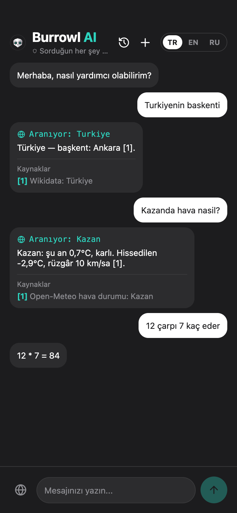
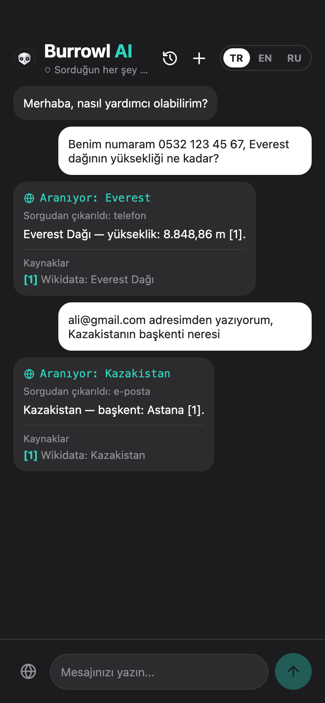
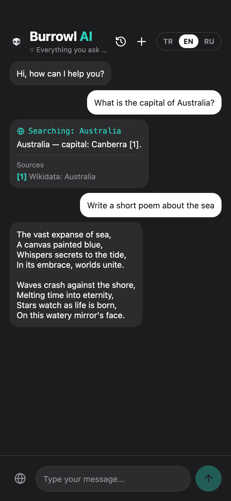
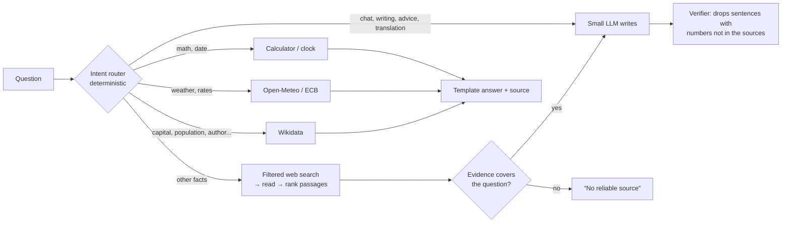

# Burrowl AI

**A privacy-first AI assistant that runs on your phone.** It answers questions with a small on-device language model and looks things up on the web when it needs to, without sending your conversation anywhere.

> Status: working MVP. The app runs on Expo (web build for development) and uses a local [Ollama](https://ollama.com) model in place of the on-device engine. The phone engine (llama.cpp via `llama.rn`) is next.

<p align="center">
  
  
  
</p>
<p align="center"><sub>Left: facts, weather and math come from tools, not from the model's memory. Middle: personal data never goes into the search, and the user is told what was removed. Right: the same app in English.</sub></p>

## Why

Cloud assistants see everything you type. Burrowl keeps the model, the chat history and the reasoning on the device. Only a short search query leaves the phone, after personal data has been removed from it, and the user sees that query.

## How it answers

A 1.5-billion-parameter model is fast enough for a phone, but it gets facts wrong and makes up numbers. So the model doesn't decide anything on its own. Code routes each question, tools fetch exact data, and the model only writes.



- **Intent router**: math, dates, weather, exchange rates, translation, writing, advice, recommendations, corrections ("that's wrong" re-runs the right tool) and "did you use the internet?" are recognized by rules, in Turkish, English and Russian.
- **Tools instead of memory**: exact answers come from Open-Meteo, the European Central Bank (via Frankfurter) and Wikidata. They take about 1–2 s and never call the model.
- **Grounded research**: other fact questions use a Wikipedia search. Results are ranked with BM25 and checked for evidence coverage before the model is asked anything. Afterwards, invented citations and unverified numbers are removed.
- **Query rewriting that can't leak answers**: the model may only reuse words that appear in the conversation, so it can't put a guessed answer or a translation into the search query.

## Privacy by design

| Guarantee | How |
|---|---|
| Personal data never goes into a search | Rule-based filter for e-mails, IBANs (country lengths), card numbers (Luhn), phone numbers, and national IDs for TR, RU and US. Unicode-safe for Turkish and Cyrillic |
| Isolated web requests | No cookies, no referrer, no cache, timeouts, size limits |
| Encrypted chat history | SQLCipher database. The key is 32 random bytes in the device keystore, only available while the device is unlocked |
| Deleted means deleted | `secure_delete`, WAL truncation and `VACUUM` after each delete. A test reads the raw database file to prove the text is gone. Android backups are disabled |
| Web text is data, not instructions | Sources are passed to the model as quoted material |
| No bot-protection bypassing | If a search site shows a CAPTCHA, the user sees it |

See [PRINCIPLES.md](PRINCIPLES.md) for the full set of project rules (in Turkish).

## Project structure

npm workspaces monorepo, TypeScript throughout:

| Package | What it does |
|---|---|
| [`apps/mobile`](apps/mobile) | Expo / React Native app: chat UI, TR/EN/RU switch, web on/auto/off switch, stop button, encrypted history |
| [`packages/assistant`](packages/assistant) | The answer pipeline: intent router, tools, prompts, templates, verifier. The UI only talks to this package |
| [`packages/privacy`](packages/privacy) | Personal-data filters for outgoing queries |
| [`packages/web-search`](packages/web-search) | Isolated fetch, Wikipedia, Wikidata, Open-Meteo and exchange-rate clients |
| [`packages/knowledge`](packages/knowledge) | Text chunking and BM25 passage ranking |
| [`packages/llm-engine`](packages/llm-engine) | Model interface: streaming Ollama client and a fake engine for tests |
| [`packages/storage`](packages/storage) | Chat store on SQLite (encrypted on device) or key-value storage (web) |
| [`tools/eval.ts`](tools/eval.ts) | End-to-end accuracy check against real sources and a real model |

## Running it

Requirements: Node.js 24+ and [Ollama](https://ollama.com).

```bash
ollama pull qwen2.5:1.5b   # the smallest model planned for phones (~1 GB)
npm install
npm run web                # opens the app in the browser
```

## Tests

```bash
npm test        # 200+ unit tests across all packages, no network needed
npm run eval    # live accuracy check (needs internet and Ollama)
```

The current eval score with `qwen2.5:1.5b` is 10/10, at about 1.9 s per answer.

## Roadmap

- On-device inference with `llama.rn` (Android first)
- Web search provider that runs on the device
- Advice mode: asks a clarifying question first, then answers using curated knowledge cards stored on the device
- Optional biometric lock

## License

[AGPL-3.0](LICENSE). The privacy claims are only worth something if anyone can check the code.
